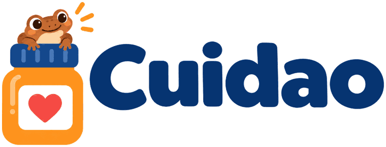
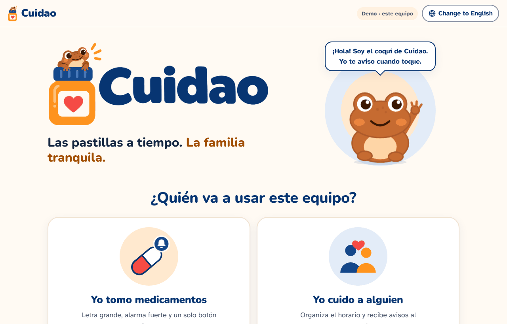
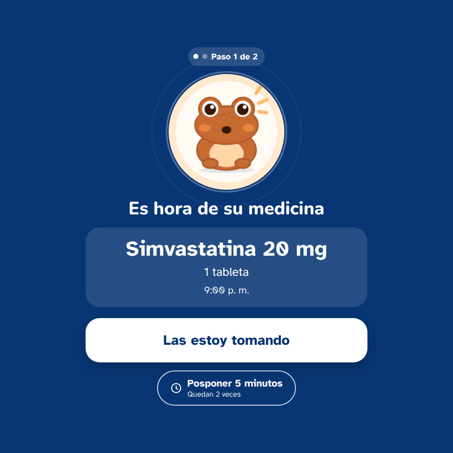
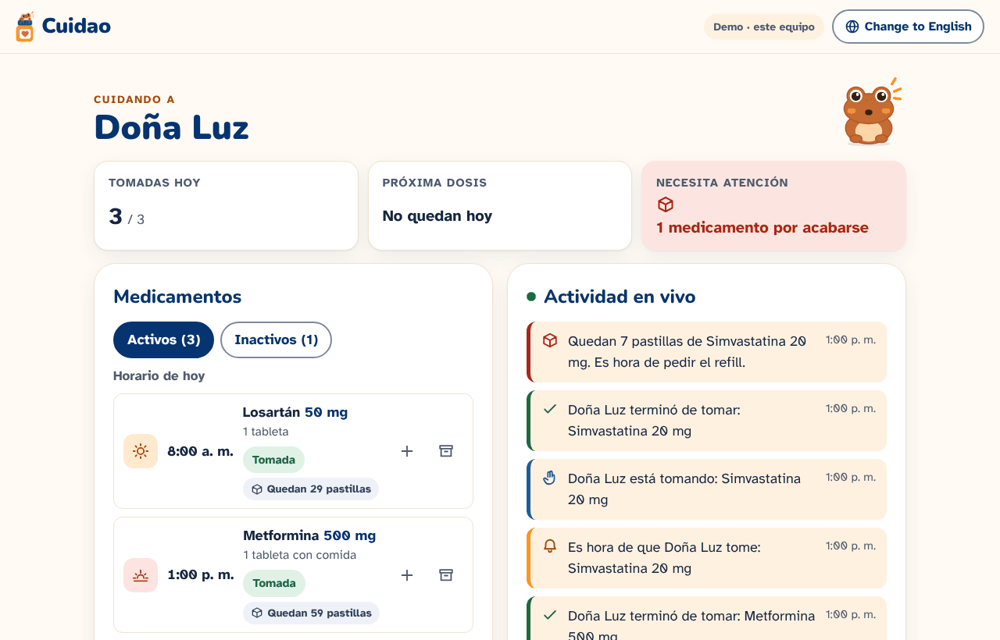
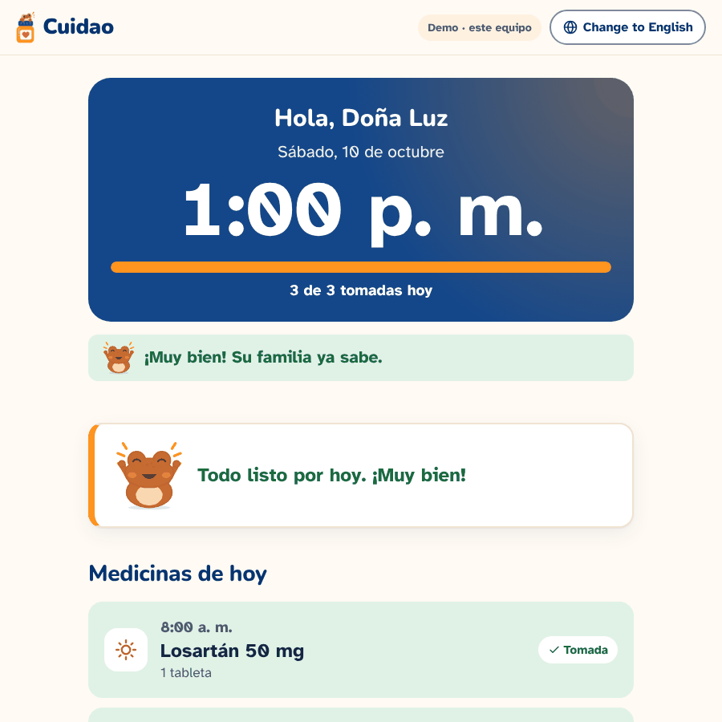
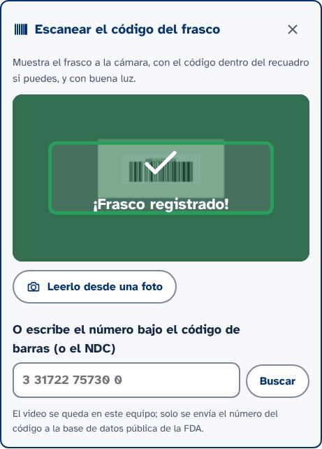
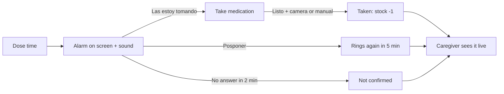

<p align="center">
  
</p>

<h3 align="center">¿Ya te las tomaste?</h3>

<p align="center"><b>Las pastillas a tiempo. La familia tranquila.</b></p>

<p align="center">
  When family lives far away or caregivers can't be there, who checks the pills?<br>
  Cuidao: a simple alarm for Puerto Rico's elders and live dose alerts for their loved ones.
</p>

<p align="center">
  
  
  
  
</p>

**Cuidao** turns any phone, tablet or computer into a large, simple medication alarm for an older adult. Each step they take is shared live with a family member or caregiver, wherever they are.

Built during the **Caribbean AI Summit Healthcare Hackathon** (October 8–10, 2026, sponsored by Centro Unido de Detallistas), in the **Patient and caregiver support** area.

> **In short:** Many older adults in Puerto Rico manage daily medications alone, while their families live far away or have little time, and care homes are costly. Cuidao gives the older adult a large, simple medication alarm and gives their family a live view of every dose, missed dose and refill. It is a working web prototype that runs with synthetic data and no account.

| | |
|---|---|
| **Repository** | [github.com/acaezcanino/cuidao](https://github.com/acaezcanino/cuidao) |
| **Live demo** | Not deployed yet. [Run it locally in two minutes](#getting-started) |
| **Demo video** | Not available yet |
| **Devpost** | Link to be added after submission |

---

## Contents

- [Inspiration](#inspiration)
- [The problem](#the-problem)
- [Our solution](#our-solution)
- [Key features](#key-features)
- [Screenshots](#screenshots)
- [How it works](#how-it-works)
- [How Cuidao meets the judging criteria](#how-cuidao-meets-the-judging-criteria)
- [Technology stack](#technology-stack)
- [Getting started](#getting-started)
- [Project architecture](#project-architecture)
- [Design decisions](#design-decisions)
- [Accessibility and safety](#accessibility-and-safety)
- [Data and privacy](#data-and-privacy)
- [Current limitations](#current-limitations)
- [Future improvements](#future-improvements)
- [Path to implementation](#path-to-implementation)
- [Hackathon submission](#hackathon-submission)
- [Team and acknowledgments](#team-and-acknowledgments)
- [License](#license)

---

## Inspiration

Cuidao started with my 98-year-old grandmother. Her only pill reminder is a basic phone alarm. When it rings, she turns it off, and later she often can't remember whether she actually took her pills. The family ends up calling to ask, *"¿Ya te las tomaste?"*

Refills are the other problem. She takes several pills a day, so it's hard for her to notice a bottle running low, and she often forgets to tell us until it's empty.

Her story is common in Puerto Rico. Cuidao is built for her, and for every older adult and caregiver dealing with the same daily hassle.

## The problem

Puerto Rico is aging quickly, and many older adults are managing their health with less support close by:

- In 2023 there were about **199 people aged 65 or older for every 100 children under 15** on the island, up from 158 in 2020 ([U.S. Census Bureau estimates, via News is my Business](https://newsismybusiness.com/census-puerto-ricos-65-population-doubles-15-and-under-group)).
- **4 in 10 households** (40.6%) include someone aged 65 or older ([Instituto de Estadísticas de Puerto Rico, PRCS 2017–2021](https://www.estadisticas.pr.gov/en-us/blogposts/firme-el-incremento-de-hogares-con-personas-65-anos-o-mas-en-puerto-rico)).
- The Office of the Ombudsman for Older Adults (OPPEA) received **7,476 complaints of abuse and crimes** against older adults between October 2024 and September 2025, **mostly neglect and financial exploitation** ([Metro Puerto Rico](https://www.metro.pr/noticias/2026/02/02/oppea-registro-mas-de-7000-querellas-de-maltrato-y-por-delitos-en-un-ano/)).

Many families live in the U.S. mainland or work long hours and can't be there every day. Care homes are expensive and often not covered by health insurance, and recent cases have exposed unlicensed homes operating without oversight ([TeleOnce](https://teleonce.com/?p=804010)).

Taking daily medication correctly is one of the most basic and most frequent care needs. Several medications at different times, plus memory or vision changes, make it easy to miss or repeat a dose. Often nobody else finds out until much later.

## Our solution

Cuidao keeps the older adult in control of their own routine and keeps the family informed:

- **For the older adult:** at each dose time, a full-screen alarm with sound and one large button at a time. No menus, no small text.
- **For the family or caregiver:** a live view of the day. They see what was taken, what is late and what was skipped, and how many pills are left. They also get alerts when something needs attention.

The goal is independence for the older adult and peace of mind for the family. Cuidao supports a medication routine. It does not replace medical care or human contact.

## Key features

**For the older adult**

- **Hard-to-miss alarm.** Full screen, sound and a two-step confirmation ("Las estoy tomando", then "Listo, ya me las tomé"), so a dose isn't marked as taken by accident.
- **Snooze, with limits.** "Posponer 5 minutos", up to two times per dose. The family is notified each time.
- **Camera confirmation.** When they tap "Listo", the camera checks that the pill bottle is in their hand, using on-device hand and bottle detection. A manual "Confirmar sin cámara" option always appears if the camera can't confirm.
- **Catches missed doses.** If an earlier dose was never confirmed, they are asked about it ("Sí, me la tomé" or "No, no me la tomé") before taking the next one.

**For the family or caregiver**

- **Live activity feed and system notifications** for every step: time to take, taking, taken, snoozed, not confirmed, not taken, low stock.
- **Today at a glance:** doses taken, the next dose, and what needs attention. A dose shows a red **"No fue tomada"** when it was skipped or a later dose was taken first.
- **Pill stock and refill alerts.** Each confirmed dose lowers the count. The caregiver is alerted when it reaches a set level, and can refill in one step.
- **Medication history.** Medications that are no longer taken move to *Inactivos*. They stop ringing and are kept for reference, with the date they were stopped.
- **Three ways to add a medication:**
  - **Scan the bottle's barcode** to fill in the name, strength (mg) and pills per bottle from the FDA's public NDC Directory.
  - **Read it from a photo** of the barcode, such as one taken with a phone.
  - **Type it in** manually: name, strength, dose, time, pills on hand and the low-stock alert level.

**For everyone:** Spanish by default (Puerto Rico time format) with a one-tap switch to English.

## Screenshots

<table>
  <tr>
    <td width="50%"></td>
    <td width="50%"></td>
  </tr>
  <tr>
    <td><b>Home.</b> Each person picks their role once.</td>
    <td><b>Alarm.</b> One large action at a time, with snooze below.</td>
  </tr>
  <tr>
    <td></td>
    <td></td>
  </tr>
  <tr>
    <td><b>Caregiver view.</b> Summary, medications with stock, and the live feed with a refill alert.</td>
    <td><b>Older adult view.</b> Large clock, progress and today's medications.</td>
  </tr>
</table>

<p align="center">
  
  <br><b>Bottle scanner.</b> The frame turns green when the bottle is registered. Captured with a test camera feed.
</p>

All screenshots are from the running app with its fictional demo data (patient "Doña Luz").

## How it works

1. A family member opens the **caregiver screen**, adds medications (name, strength, dose, time, pills on hand) or scans a bottle.
2. On the older adult's device, the **older adult screen** stays open. It checks the schedule every few seconds.
3. At dose time, the **alarm** goes off, and the caregiver gets "Es hora de que Doña Luz tome…".
4. The older adult taps **"Las estoy tomando"**, takes the medication, then taps **"Listo"** and shows the bottle to the camera, or confirms without it.
5. The dose is marked **taken**, the pill count goes down, and the caregiver sees each step live.
6. If they snooze, don't answer within 2 minutes, or say they didn't take a dose, the caregiver is alerted.



## How Cuidao meets the judging criteria

| Criterion | How Cuidao addresses it | Where to see it |
|---|---|---|
| **Healthcare Impact & Local Relevance** | Puerto Rico has about 199 adults aged 65+ for every 100 children, 4 in 10 homes include an older adult, and neglect is the most common complaint to the Ombudsman for Older Adults. Cuidao supports one of the most frequent daily care needs, taking medication correctly, and connects the older adult with family who may live far away. It is meant to help patients and family caregivers. | [The problem](#the-problem) |
| **Quality of the Idea** | Two connected screens built for two different people: a single-action alarm for the older adult, and a live dashboard for the caregiver. The flow handles real situations: snoozing, no answer, a missed earlier dose, running out of pills, and stopping a medication. | [Our solution](#our-solution), [Key features](#key-features) |
| **Prototype Execution** | The full flow works end to end in the browser with no account: alarm, two-step confirmation with camera check, snooze, missed-dose handling, live caregiver feed, stock and refill alerts, history, and the bottle scanner with FDA data. The technology fits the need: on-device computer vision, a public FDA API, and real-time sync with optional Supabase. | [Evaluate it in 3 minutes](#evaluate-it-in-3-minutes), [Screenshots](#screenshots) |
| **Feasibility & Responsible Design** | It runs on devices families already have, with no new hardware. It uses synthetic data only, keeps camera processing on the device, sends no personal data to outside services, and never makes medical decisions. Limitations, including one simulated prototype feature, are written down. | [Data and privacy](#data-and-privacy), [Current limitations](#current-limitations), [Path to implementation](#path-to-implementation) |
| **Usability & Clarity** | Designed for older adults: one large button at a time, large text, a high-contrast palette, Spanish by default with English available, a screen-reader-friendly alarm, and a friendly coquí mascot. The caregiver sees what needs attention at a glance. | [Accessibility and safety](#accessibility-and-safety), [Design decisions](#design-decisions) |

## Technology stack

| Area | Technology | Purpose |
|---|---|---|
| Frontend | React 19, Vite 8 | User interface and build |
| Styling | Plain CSS with design tokens (`src/App.css`), Nunito and Atkinson Hyperlegible fonts | Consistent, readable visual system |
| Data (demo mode) | `localStorage` + `BroadcastChannel` | Runs with no account. Screens sync inside one browser |
| Data (live mode) | Supabase (Postgres + Realtime), optional | Sync between the older adult's and the caregiver's devices |
| Alarms and alerts | Web Audio API, Notifications API | Alarm sound, chime and system notifications |
| Computer vision | MediaPipe Hand Landmarker, YOLO11n via ONNX Runtime Web | On-device hand and bottle detection for the camera features |
| Barcodes | zxing-wasm (ZXing-C++ in WebAssembly), native `BarcodeDetector` when available | Reading bottle barcodes |
| Medication data | openFDA NDC Directory API | Name, strength and package size from a barcode |

There is no custom backend. In demo mode everything runs in the browser.

## Getting started

### Prerequisites

- [Node.js](https://nodejs.org) 22 LTS (or 20.19+), as required by Vite 8
- Git
- Chrome or Edge (recommended)

### Install and run

```bash
git clone https://github.com/acaezcanino/cuidao.git
cd cuidao
npm install
npm run dev
```

Open the URL Vite prints, usually `http://localhost:5173`. No account or `.env` file is needed for demo mode.

`npm install` also downloads the MediaPipe hand model into `public/vision/models/` if it's missing. To fetch it again, run `npm run models`.

### Evaluate it in 3 minutes

1. Open these two pages as **two tabs in the same browser**:
   - Older adult: `http://localhost:5173/#senior`
   - Caregiver: `http://localhost:5173/#caregiver`
2. Tap the start button in each tab. This lets the browser play sound and show notifications.
3. Open the test panel at `http://localhost:5173/#admin` and press **Sonar ahora** on any dose. It rings immediately, at any hour.
4. Follow the alarm on the older adult tab and watch each step appear on the caregiver tab.
5. Simvastatina starts with 8 pills. Take it once to see the low-stock alert.

Opening the test panel switches to short demo timings: 30-second snooze and 30 seconds to "not confirmed". Tap **"Salir del modo prueba"** in the yellow bar to return to the real timings.

### Optional: live mode with Supabase

1. Create a project at [supabase.com](https://supabase.com) and run `supabase/schema.sql` in its SQL Editor.
2. Copy `.env.example` to `.env.local` and add your project URL and publishable key:

   ```bash
   VITE_SUPABASE_URL=
   VITE_SUPABASE_PUBLISHABLE_KEY=
   VITE_SENIOR_NAME=Doña Luz      # optional
   VITE_GRACE_MINUTES=2           # optional: minutes before "not confirmed"
   ```

3. Restart `npm run dev`.

The included database policies are for demos only and allow anyone with the key to read and write. Use fictional data.

### Troubleshooting

- **The caregiver tab doesn't update.** Both tabs must be in the same browser. A Chrome tab and an Edge tab can't see each other in demo mode.
- **No sound.** Tap the start button in the older adult tab, and keep that tab open.
- **The camera doesn't start.** Allow camera access with the icon next to the address bar, and close other apps that are using the camera.

## Project architecture

```
src/
  App.jsx             Routes (#senior, #caregiver, #admin), home screen, language switch
  SeniorView.jsx      Older adult screen: clock, schedule, alarm and dose scheduler
  CaregiverView.jsx   Caregiver screen: summary, medications, stock, history, live feed
  AdminPanel.jsx      Test panel for demos
  store.js            Data layer (demo mode or Supabase, same API) and dose status rules
  BarcodeScanner.jsx  Bottle scanner (live camera, photo or typed number)
  ndc.js              Barcode to NDC conversion and openFDA lookup
  CameraCheck.jsx     Camera confirmation at alarm step 2
  vision.js           Loads and runs MediaPipe and YOLO11n in the browser
  visionLogic.js      Detection decoding and "holding the bottle" logic
  alarm.js            Alarm sound, chime, system notifications
  i18n.js             Spanish and English text
public/brand/         Logo and mascot assets
public/vision/models/ YOLO11n (ONNX) and MediaPipe hand model
supabase/schema.sql   Database tables, realtime and demo policies
docs/SYSTEM_DESIGN.md Detailed architecture, design system and decision log
```

The two screens never talk to each other directly. Both read and write **dose events** (due, started, completed, snoozed, missed, skipped, low stock) through `store.js`, and each screen derives its status from those events. The same code works in demo mode and with Supabase.

## Design decisions

- **One decision per screen for the older adult.** The alarm shows a single large button at a time. Confirming takes two taps, so a dose isn't marked as taken by accident.
- **Spanish first.** Puerto Rico date and time formats (`es-PR`), with English one tap away.
- **Works with no account.** Demo mode needs no sign-up or server, so anyone can try the full flow in seconds. Supabase is optional.
- **The caregiver always knows the outcome.** Snoozes are capped. An unanswered alarm becomes "not confirmed", and an earlier missed dose must be answered before the next one, so a dose can't silently disappear.
- **Privacy by design for the camera.** Hand and bottle detection run on the device. No video is stored or uploaded. The scanner only sends the barcode number to the FDA.
- **Never blocks the older adult.** If the camera or models fail, a manual confirmation is always available.
- **Honest limits in the code.** Medical decisions (whether to take a missed dose) are left to people. The app only records what happened.

More detail is in [`docs/SYSTEM_DESIGN.md`](docs/SYSTEM_DESIGN.md).

## Accessibility and safety

Implemented:

- Large touch targets: 48 px or more for buttons, 88 px for the alarm's main action.
- Contrast-checked color palette, targeting WCAG 2.2 AA.
- Readable typography: Atkinson Hyperlegible, a font designed for low-vision readers.
- The alarm is an accessible modal (`alertdialog`). It moves focus to its button and makes the page behind it inactive.
- Status changes are announced to screen readers (`aria-live`). There is a skip link, visible keyboard focus, and correct `lang` for each language.
- Animations respect the "reduce motion" setting.

A full accessibility audit with assistive-technology users has not been done yet.

**Safety:** Cuidao is an organizational aid, not a medical device. It does not choose doses, change prescriptions or check drug interactions. Doses are confirmed by the user. The camera check shows that the bottle was in the person's hand, not that the pill was swallowed. FDA data is shown for reference and should be compared with the label.

## Data and privacy

- **Synthetic data only.** The patient "Doña Luz" and her medications are fictional. The repository contains no real patient records, no confidential information and no credentials.
- **No secrets in the code.** Supabase keys go in `.env.local`, which git ignores. Only the empty template `.env.example` is committed.
- **Data stays local by default.** In demo mode, everything is stored in the browser (`localStorage`) and nothing is sent to a server.
- **Camera stays on the device.** Hand and bottle detection run in the browser. No image or video is recorded or uploaded.
- **Minimal outside requests.** The barcode scanner sends only the barcode number to the FDA's public API. No personal information is sent.
- **Before real use**, Cuidao would need user accounts, per-user database security and a review of health-privacy obligations (such as HIPAA). The demo database policies are not meant for real patient data.

## Current limitations

- **Alarms need the older adult's page to be open** (it can be in the background). Alerts while the app is fully closed would need server-sent web push.
- **Demo mode keeps data in one browser.** Syncing between two phones requires the optional Supabase setup.
- **No user accounts yet.** The demo database policies are not secure for real patient data.
- **Pharmacy labels** usually encode the prescription number, which is not in any public database. Manufacturer and over-the-counter bottles carry the NDC barcode the scanner can look up.
- **Simulated bottle registration (prototype only).** When the scanner sees a bottle it can't identify (unreadable barcode, pharmacy label or no internet), it registers a fixed medication, *Levothyroxine 50 mcg, 30 tablets*, so the flow can be shown in a demo. It does not identify the real medication. See `docs/SYSTEM_DESIGN.md` §18.
- **Testing:** the main flows were checked with Playwright end-to-end scripts during development. Those scripts are not yet included in this repository. The camera features have been tested with simulated camera input, not yet with a wide range of real bottles and webcams.

## Future improvements

Planned, not yet available:

- A personalized alarm voice: the main caregiver records a short message (for example, "Mami, es hora de tus pastillas") that plays instead of the standard alarm sound.
- Push notifications and SMS/WhatsApp alerts when the app is closed (Supabase Edge Functions + Web Push).
- Accounts with Supabase Auth: one older adult linked to several family members, with secure per-user access.
- Editing medications and schedules (today they can be added, deactivated or deleted).
- Weekly adherence reports to share with the doctor.
- A detection model trained on real pill bottles, and recognition of the hand-to-mouth movement.
- Automated tests in the repository, and accessibility testing with older adults in Puerto Rico.

## Path to implementation

A realistic route from prototype to real use, not yet started:

1. **Pilot with a few families** in Puerto Rico: one older adult and one or two relatives each, using the live mode with Supabase.
2. **Add accounts and security:** Supabase Auth, per-family access rules and alerts when the app is closed (web push or SMS).
3. **Test with older adults** for usability and accessibility, and refine the alarm and the language.
4. **Distribution:** community pharmacies and caregiver organizations could offer Cuidao when medications are picked up, by scanning the bottle to add it.

## Hackathon submission

| Requirement | Where it is |
|---|---|
| Project name | Cuidao |
| Team members | See [Team and acknowledgments](#team-and-acknowledgments) |
| Healthcare problem, intended users and solution | [Inspiration](#inspiration), [The problem](#the-problem), [Our solution](#our-solution) |
| Working demo or demo video | [Getting started](#getting-started) runs the full prototype locally. Video link to be added |
| Code repository with instructions | This repository: [Getting started](#getting-started) |
| Synthetic data only, no patient records or credentials | [Data and privacy](#data-and-privacy) |

## Team and acknowledgments

- **Alondra Cáez Canino**, design and development

Built for the **Caribbean AI Summit Healthcare Hackathon** (October 8–10, 2026), sponsored by the Centro Unido de Detallistas (CUD).

Third-party data and models:

- Medication data from the U.S. Food and Drug Administration, [openFDA](https://open.fda.gov) (public domain). Not validated for clinical use.
- [YOLO11](https://github.com/ultralytics/ultralytics) by Ultralytics (AGPL-3.0).
- [MediaPipe](https://github.com/google-ai-edge/mediapipe) by Google (Apache-2.0).
- [zxing-wasm](https://github.com/Sec-ant/zxing-wasm), [ONNX Runtime Web](https://github.com/microsoft/onnxruntime) and [supabase-js](https://github.com/supabase/supabase-js) (MIT).

## License

This repository does not have an open-source license yet. Note that the bundled YOLO11 model is licensed AGPL-3.0, which requires that any distribution of this project keep its source code available under compatible terms. AGPL-3.0 is the simplest compatible choice.
